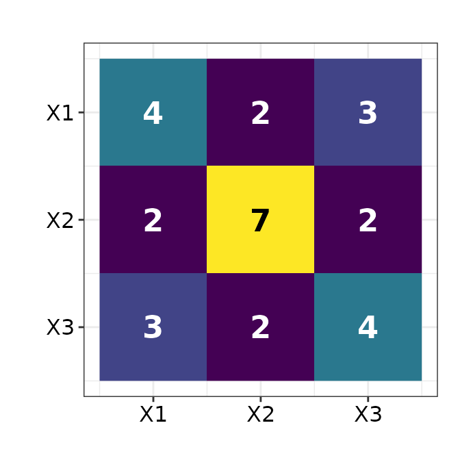
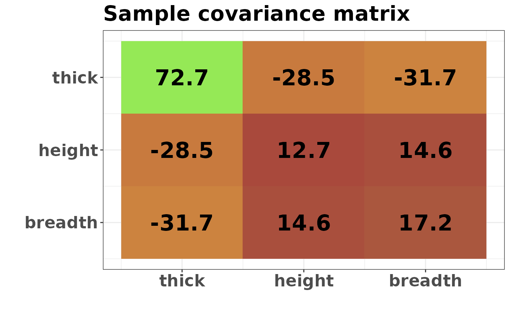
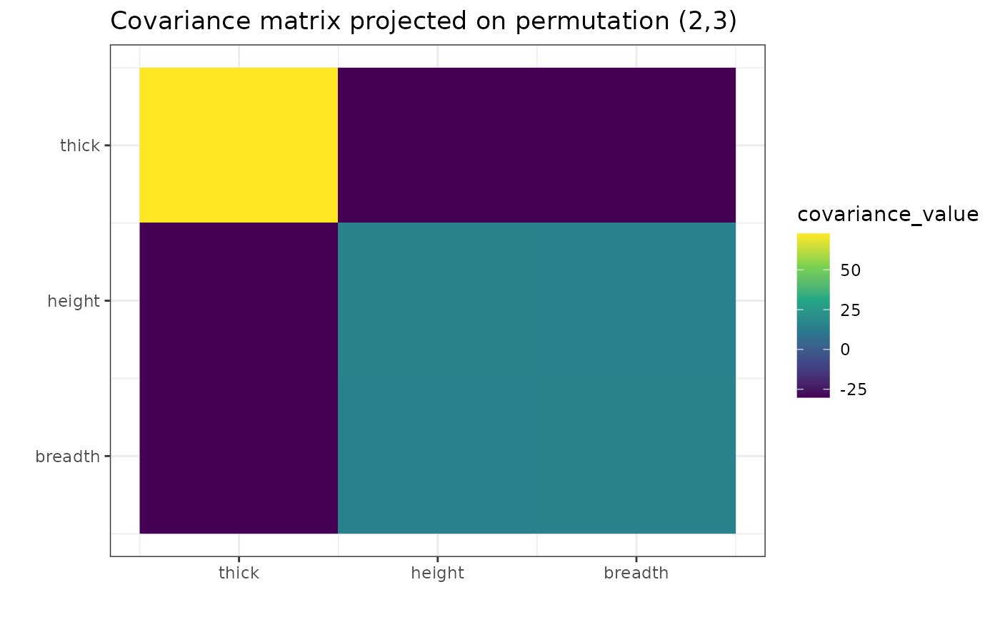
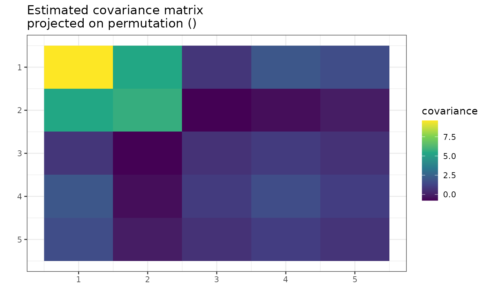
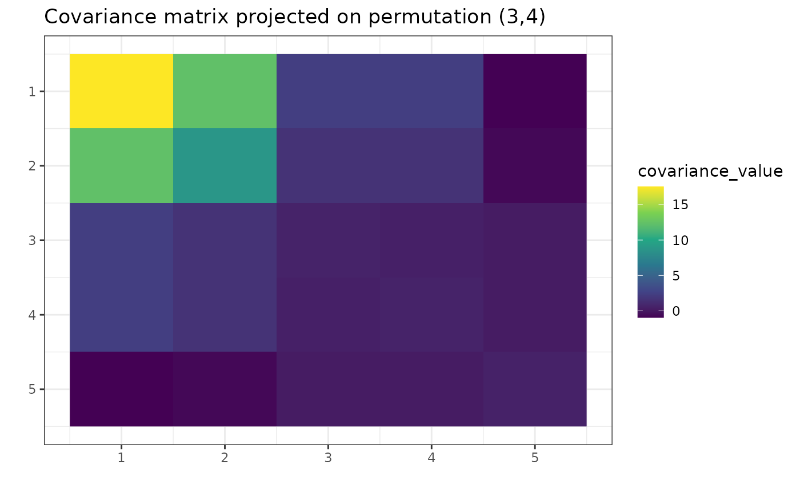
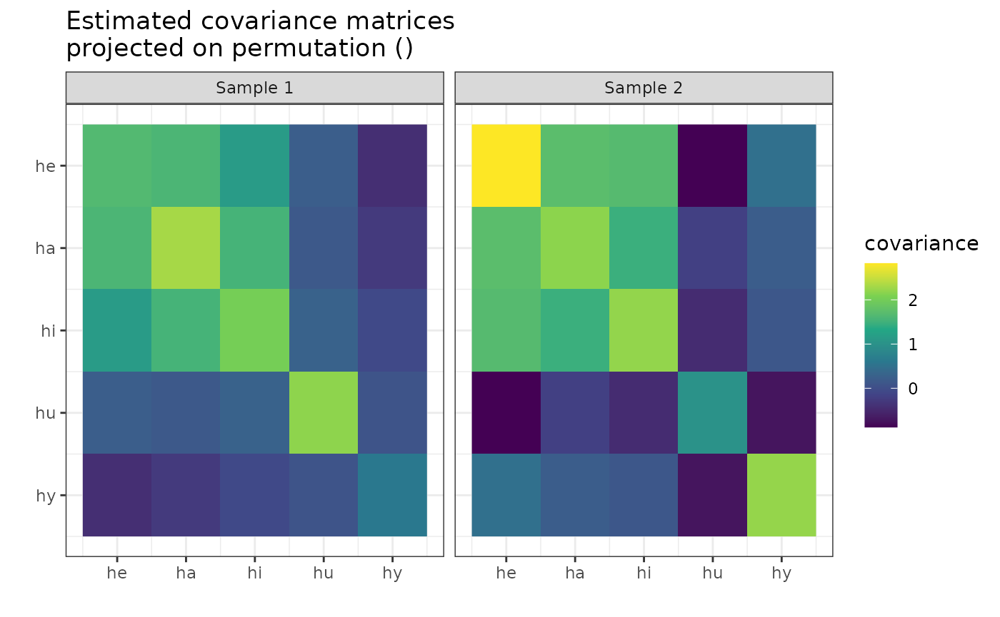
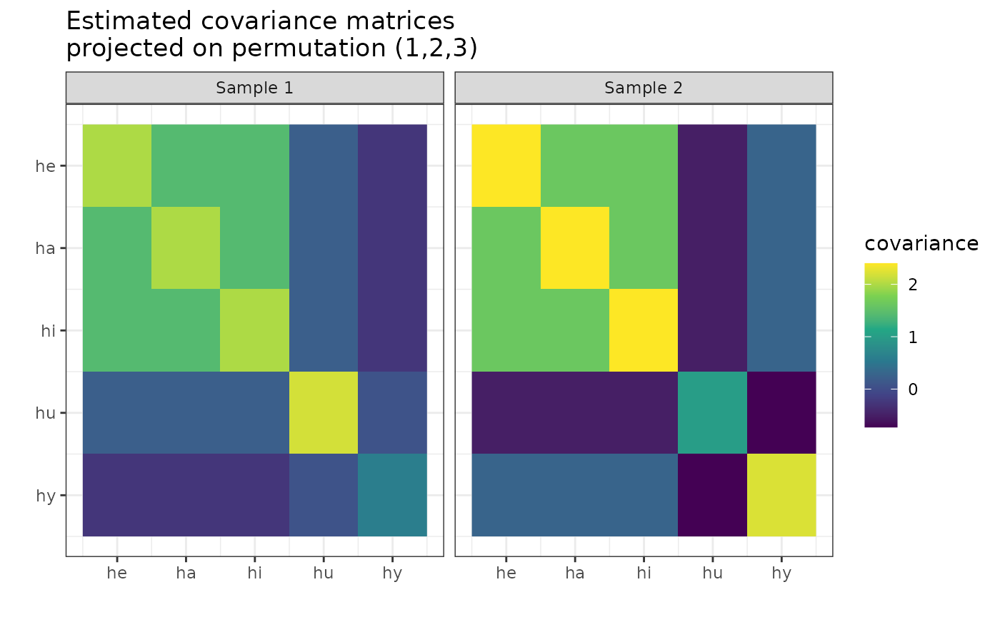

# A Gentle Introduction to Modeling with gips

## The problem

Often, we have too little data to perform valid inferences. Consider the
situation with multivariate Gaussian distribution, where we have few
observations compared to the number of variables. For example, that’s
the case for graphical models used in biology or medicine. In such a
setting, the usual way of finding the covariance matrix (the maximum
likelihood method) isn’t statistically applicable. What now?

## Invariance by permutation

Sometimes, the interchange of variables in the vector does not change
its distribution. For a multivariate Gaussian vector, this happens
exactly when both its mean vector and covariance matrix remain unchanged
under the interchange. For example, consider a Gaussian vector with zero
mean and the following positive definite covariance matrix. Variables X1
and X3 are interchangeable, meaning that vectors (X1, X2, X3) and (X3,
X2, X1) have the same distribution.



Now, we can state this interchangeability property in terms of
permutations. In our case, the distribution of (X1, X2, X3) is
**invariant by permutation** ($`1\mapsto3`$, $`3\mapsto1`$), or in
cyclic form $`(1,3)(2)`$. This is equivalent to saying that swapping the
first with the third row and then swapping the first and third columns
of the covariance matrix results in the same matrix. Then we say that
this covariance matrix is **invariant by permutation**.

Of course, in the samples collected in the real world, no perfect
equalities will be observed. Still, if the respective values in the
(poorly) estimated covariance matrix were close, adopting a particular
assumption about invariance by permutation would be a reasonable step.

## Package `gips`

We propose creating a set of constraints on the covariance matrix to use
the maximum likelihood method. The constraint we consider is - none
other than - invariance under permutation symmetry.

This package provides a way to find a *reasonable* permutation to be
used as a constraint in covariance matrix estimation. In this case,
*reasonable* means maximizing the Bayesian posterior distribution when
using a Wishart-like prior on the precision matrix (the inverse
covariance matrix). The idea, exact formulas, and algorithm sketch are
explored in another vignette that can be accessed by
[`vignette("Theory", package="gips")`](https://przechoj.github.io/gips/articles/Theory.md)
or on its [pkgdown
page](https://przechoj.github.io/gips/articles/Theory.html).

For an in-depth analysis of the package performance, capabilities, and
comparison with other packages, see the article “Learning permutation
symmetries with gips in R” by `gips`’ developers Adam Chojecki, Paweł
Morgen, and Bartosz Kołodziejek, [Journal of Statistical
Software](https://doi.org/10.18637/jss.v112.i07).

## Practical example

Let’s examine thickness, height, and breadth data from 12 books:

``` r

library(gips)

Z <- DAAG::oddbooks[, c(1, 2, 3)]
```

We suspect books from this dataset were printed with $`\sqrt{2}`$ aspect
ratio as in popular [A-series paper
size](https://en.wikipedia.org/wiki/Paper_size#A_series). Therefore, we
can use this expert knowledge in the analysis and unify the data for
height and width:

``` r

Z$height <- Z$height / sqrt(2)
```

Now, let’s plot the data:

``` r

number_of_observations <- nrow(Z) # 12
p <- ncol(Z) # 3

S <- cov(Z)
round(S, 1)
#>         thick height breadth
#> thick    72.7  -28.5   -31.7
#> height  -28.5   12.7    14.6
#> breadth -31.7   14.6    17.2
g <- gips(S, number_of_observations)
plot_cosmetic_modifications(plot(g, type = "heatmap")) +
  ggplot2::ggtitle("Sample covariance matrix")
```



We can see similarities between columns 2 and 3, representing the book’s
height and breadth. In particular, the covariance between \[1,2\] is
very similar to \[1,3\], and the variance of \[2\] is similar to the
variance of \[3\]. Those are not surprising, given the data
interpretation (after the rescaling of height that we did).

Let’s see what the `gips` will tell about this data:

``` r

g_map <- find_MAP(g,
  optimizer = "brute_force",
  return_probabilities = TRUE, save_all_perms = TRUE
)
#> ================================================================================
#> ================================================================================
#> ================================================================================

g_map
#> The permutation (2,3):
#>  - was found after 5 posteriori calculations;
#>  - is 1.305 times more likely than the () permutation.
get_probabilities_from_gips(g_map)
#>          (2,3)             ()          (1,3)        (1,2,3)          (1,2) 
#> 0.566078057717 0.433908667868 0.000006728772 0.000004683290 0.000001862353
```

[`find_MAP()`](https://przechoj.github.io/gips/reference/find_MAP.md)
found the symmetry represented by permutation (2,3). Here BF gives the
full posterior over cyclic groups. See
[`vignette("Optimizers", package = "gips")`](https://przechoj.github.io/gips/articles/Optimizers.md)
for discussion on how to use it with MH.

``` r

plot_cosmetic_modifications(plot(g_map, type = "heatmap"))
```



``` r

round(project_matrix(S, g_map), 1)
#>         thick height breadth
#> thick    72.7  -30.1   -30.1
#> height  -30.1   14.9    14.6
#> breadth -30.1   14.6    14.9
```

The selected symmetry depends on two hyperparameters, `delta` and
`D_matrix`. By default, they are set to `3` and `d * diag(p)`,
respectively, where `d = mean(diag(S))`. We recommend comparing results
for different values of `D_matrix = d * diag(p)`, where $`d > 0`$. For a
fixed permutation, the projection returned by
[`project_matrix()`](https://przechoj.github.io/gips/reference/project_matrix.md)
does not depend on either hyperparameter. The impact analysis of those
can be read in \[2\] in section *3.2. Hyperparameter’s influence*.

## Theoretic example

``` r

p <- 5
number_of_observations <- 4
mu <- runif(p, -10, 10) # Assume we don't know the mean
sigma_matrix <- matrix(c(
  8.4, 4.1, 1.9, 1.9, 1.9,
  4.1, 3.5, 0.3, 0.3, 0.3,
  1.9, 0.3, 1,   0.8, 0.8,
  1.9, 0.3, 0.8, 1,   0.8,
  1.9, 0.3, 0.8, 0.8, 1
), ncol = p)
# sigma_matrix is a matrix invariant under permutation (3,4,5)
toy_example_data <- withr::with_seed(2022,
  code = MASS::mvrnorm(number_of_observations,
    mu = mu, Sigma = sigma_matrix
  )
)
```

Show/hide data preparation

``` r

library(gips)

toy_example_data
#>            [,1]     [,2]      [,3]      [,4]       [,5]
#> [1,]  -5.554883 7.466693 2.9365870 -6.012184  -9.612169
#> [2,] -11.330708 1.700968 3.4492219 -5.981525  -8.894789
#> [3,] -10.579451 3.914784 1.5836832 -6.700888  -9.756382
#> [4,] -12.634411 4.881232 0.6227172 -7.743648 -10.812462

dim(toy_example_data)
#> [1] 4 5
number_of_observations <- nrow(toy_example_data) # 4
p <- ncol(toy_example_data) # 5

S <- cov(toy_example_data)

sum(eigen(S)$values > 0.00000001)
#> [1] 3
```

Note that the rank of the `S` matrix is 3, despite the
`number_of_observations` being 4. This is because
[`cov()`](https://rdrr.io/r/stats/cor.html) estimated the mean on every
column to compute `S`.

We want to find reasonable additional assumptions on `S` to make it
easier to estimate.

``` r

g <- gips(S, number_of_observations)

plot(g, type = "heatmap")
```



Looking at the plot, one can see the similarities between columns 3, 4,
and 5. They have similar variance and covariance to each other. The 3
and 5 have similar covariance with columns 1 and 2. However, the 4 is
also close.

Let’s see if `gips` will find the relationship:

``` r

g_map <- find_MAP(g,
  optimizer = "brute_force",
  return_probabilities = TRUE, save_all_perms = TRUE
)
#> ================================================================================
#> ================================================================================
#> ================================================================================

plot(g_map, type = "heatmap")
```



`gips` decided that $`(3,4,5)`$ was the most reasonable assumption.
Let’s see how much better it is:

``` r

g_map
#> The permutation (3,4,5):
#>  - was found after 67 posteriori calculations;
#>  - is 3.63 times more likely than the () permutation.
```

This assumption is 3.63 times more believable than making no assumption.
Let’s examine how reasonable other possible assumptions are:

``` r

toy_probabilities <- get_probabilities_from_gips(g_map)
toy_probabilities
#>      (3,4,5)      (2,3,5) (1,2)(3,4,5)   (2,3)(4,5)      (2,3,4)        (4,5) 
#>  0.060795897  0.051327650  0.047543805  0.043479702  0.042258173  0.037444039 
#>        (3,4)    (2,4,3,5)    (2,3,5,4)        (2,3)        (3,5)    (2,3,4,5) 
#>  0.036974591  0.036537592  0.035288679  0.035029003  0.034387822  0.033253087 
#> (1,2,3)(4,5)   (1,2)(3,4)   (1,2)(3,5)   (1,2)(4,5)    (1,2,5,3)      (2,4,5) 
#>  0.027117327  0.026461675  0.025577690  0.024936845  0.018903085  0.018746139 
#>   (2,5)(3,4)           ()   (2,4)(3,5)    (1,3,2,5)  (1,2,4,5,3)    (1,2,4,3) 
#>  0.018700989  0.016750327  0.015663346  0.015307451  0.014592485  0.014039967 
#>      (1,2,3)        (2,5)        (1,2)        (2,4)    (1,3,2,4) (1,4)(2,3,5) 
#>  0.013997807  0.013485936  0.012967999  0.011923087  0.011841521  0.011196394 
#>  (1,2,5,4,3)  (1,2,5,3,4) (1,2,5)(3,4) (1,2,4)(3,5)  (1,2,3,5,4) (1,3)(2,4,5) 
#>  0.010785372  0.010419982  0.010409290  0.010365568  0.009845095  0.009702158 
#>  (1,2,4,3,5) (1,5)(2,3,4)   (1,3)(2,5)    (1,2,3,5)    (1,2,3,4)  (1,2,3,4,5) 
#>  0.009651125  0.009104584  0.008944279  0.008695051  0.007651747  0.007588575 
#>   (1,3)(4,5)   (1,3)(2,4)    (1,4,2,5)      (1,2,4)      (1,2,5)    (1,2,5,4) 
#>  0.006593231  0.005343025  0.005328589  0.005157984  0.005040218  0.004559069 
#>   (1,5)(2,3)   (1,4)(2,3)   (1,4)(3,5)    (1,2,4,5)        (1,3) (1,4,5)(2,3) 
#>  0.004283906  0.004131646  0.003985042  0.003944406  0.003585326  0.003141217 
#>   (1,5)(3,4)   (1,4)(2,5) (1,3,4)(2,5)        (1,4)      (1,3,4)        (1,5) 
#>  0.003043179  0.002773443  0.002564496  0.002403143  0.002179071  0.002082365 
#>      (1,3,5)   (1,5)(2,4) (1,3,5)(2,4)      (1,4,5)    (1,3,5,4)    (1,3,4,5) 
#>  0.001874883  0.001849327  0.001777368  0.001376319  0.001233471  0.001030074 
#>    (1,4,3,5) 
#>  0.001026267
```

We see that assumption $`(3,4,5)`$ is the most likely with a 6.1%
posterior probability. 19 cyclic groups are more likely than id.

Remember that the `n0` could still be too big for your data. In this
example, the assumptions with transpositions (like $`(3,5)`$) would
yield the `n0` $`= 5`$, which would be insufficient for us to estimate
covariance correctly. The assumption $`(3,4,5)`$ will be just right:

``` r

summary(g_map)$n0 # compare n0 with number_of_observations
#> [1] 4

S_projected <- project_matrix(S, g_map)
S_projected
#>          [,1]       [,2]       [,3]       [,4]       [,5]
#> [1,] 9.601087  5.4152903  1.4727442  1.4727442  1.4727442
#> [2,] 5.415290  5.7077767 -0.4783693 -0.4783693 -0.4783693
#> [3,] 1.472744 -0.4783693  0.9870649  0.8600285  0.8600285
#> [4,] 1.472744 -0.4783693  0.8600285  0.9870649  0.8600285
#> [5,] 1.472744 -0.4783693  0.8600285  0.8600285  0.9870649
sum(eigen(S_projected)$values > 0.00000001)
#> [1] 5
```

Now, the estimated covariance matrix is of full rank (5).

## Multi-sample example

Sometimes, we may have several independent groups that should share the
same permutation symmetry, while each group has its own covariance
matrix. In this case, pass a list of covariance matrices as `S` and a
vector of sample sizes as `number_of_observations`.

Every matrix must describe the same variables in the same row and column
order. `gips` applies a shared permutation to matching matrix indices;
it does not match or reorder variables using matrix names.

The two covariance matrices below are different, but both are invariant
under the permutation $`(1,2,3)`$:

``` r

p <- 5
n1 <- 20
n2 <- 23

sigma_matrix_1 <- matrix(c(
  1.50,  0.95,  0.95,  0.30, -0.05,
  0.95,  1.50,  0.95,  0.30, -0.05,
  0.95,  0.95,  1.50,  0.30, -0.05,
  0.30,  0.30,  0.30,  2.40,  0.05,
 -0.05, -0.05, -0.05,  0.05,  0.60
), nrow = p, byrow = TRUE)

sigma_matrix_2 <- matrix(c(
  2.10,  1.40,  1.40, -0.35,  0.55,
  1.40,  2.10,  1.40, -0.35,  0.55,
  1.40,  1.40,  2.10, -0.35,  0.55,
 -0.35, -0.35, -0.35,  0.80, -0.30,
  0.55,  0.55,  0.55, -0.30,  2.80
), nrow = p, byrow = TRUE)

data_sample_1 <- withr::with_seed(21, 
  MASS::mvrnorm(n1, mu = rep(0, p), Sigma = sigma_matrix_1)
)

data_sample_2 <- withr::with_seed(37, 
  MASS::mvrnorm(n2, mu = rep(0, p), Sigma = sigma_matrix_2)
)

S1 <- cov(data_sample_1)
S2 <- cov(data_sample_2)

variable_names <- c("he", "ha", "hi", "hu", "hy")
dimnames(S1) <- list(variable_names, variable_names)
dimnames(S2) <- list(variable_names, variable_names)

S_by_group <- list("Sample 1" = S1, "Sample 2" = S2)
```

Let us look at the sample covariance matrices:

``` r

g_multi <- gips(S_by_group, c(n1, n2))

plot(g_multi, type = "MLE")
```



We see that the estimated covariances are different, but both look
approximately invariant under the $`(1,2,3)`$ permutation.

Now we can fit one shared symmetry model to both covariance matrices:

``` r

g_multi_map <- find_MAP(g_multi,
  optimizer = "brute_force",
  return_probabilities = TRUE, save_all_perms = TRUE,
  show_progress_bar = FALSE
)

g_multi_map
#> The permutation (1,2,3):
#>  - was found after 67 posteriori calculations;
#>  - is 2147633.177 times more likely than the () permutation.
multi_probabilities <- get_probabilities_from_gips(g_multi_map)
head(multi_probabilities, 5)
#>      (1,2,3) (1,2,3)(4,5)        (2,3)        (1,3)   (1,5)(2,3) 
#> 0.5626843561 0.4333038479 0.0021741302 0.0009889950 0.0002932819
```

The MAP symmetry is $`(1,2,3)`$, matching the shared symmetry used to
generate both groups. Its posterior probability is about 56.3%. The
projected covariance estimate is also returned as one matrix per group:

``` r

S_multi_projected <- project_matrix(S_by_group, g_multi_map)

round(S_multi_projected[[1]], 2)
#>       he    ha    hi   hu    hy
#> he  1.99  1.42  1.42 0.22 -0.26
#> ha  1.42  1.99  1.42 0.22 -0.26
#> hi  1.42  1.42  1.99 0.22 -0.26
#> hu  0.22  0.22  0.22 2.18  0.08
#> hy -0.26 -0.26 -0.26 0.08  0.61
round(S_multi_projected[[2]], 2)
#>       he    ha    hi    hu    hy
#> he  2.40  1.62  1.62 -0.51  0.28
#> ha  1.62  2.40  1.62 -0.51  0.28
#> hi  1.62  1.62  2.40 -0.51  0.28
#> hu -0.51 -0.51 -0.51  1.01 -0.73
#> hy  0.28  0.28  0.28 -0.73  2.22

plot(g_multi_map, type = "MLE")
```



If we analyze the two groups separately, the shared symmetry is less
clear:

``` r

g_1_map <- find_MAP(gips(S1, n1),
  optimizer = "BF",
  return_probabilities = TRUE,
  save_all_perms = TRUE,
  show_progress_bar = FALSE
)

g_2_map <- find_MAP(gips(S2, n2),
  optimizer = "BF",
  return_probabilities = TRUE,
  save_all_perms = TRUE,
  show_progress_bar = FALSE
)

group_1_probabilities <- get_probabilities_from_gips(g_1_map)
group_2_probabilities <- get_probabilities_from_gips(g_2_map)

head(group_1_probabilities, 5)
#>      (1,2,3) (1,2,3)(4,5)      (2,3,4)   (1,2)(3,4)        (2,3) 
#>   0.49456331   0.23279372   0.04635442   0.03723094   0.02928359
head(group_2_probabilities, 5)
#> (1,2,3)(4,5)      (1,2,3)      (1,3,5)        (1,3)        (2,3) 
#>   0.51933859   0.31744775   0.05597950   0.02090608   0.02071526
```

The separate analyses are more ambiguous. The true $`(1,2,3)`$
permutation has posterior probability about 49.5% in the first sample
and only about 31.7% in the second sample. The multi-sample fit combines
evidence from both groups while requiring one shared permutation
symmetry.

## Further reading

1.  To learn more about the available optimizers in
    [`find_MAP()`](https://przechoj.github.io/gips/reference/find_MAP.md)
    and how to use those, see
    [`vignette("Optimizers", package="gips")`](https://przechoj.github.io/gips/articles/Optimizers.md)
    or its [pkgdown
    page](https://przechoj.github.io/gips/articles/Optimizers.html).
2.  To learn more about the math and theory behind the `gips` package,
    see
    [`vignette("Theory", package="gips")`](https://przechoj.github.io/gips/articles/Theory.md)
    or its [pkgdown
    page](https://przechoj.github.io/gips/articles/Theory.html).
3.  For an in-depth analysis of the package performance, capabilities,
    and comparison with other packages, see the article “Learning
    permutation symmetries with gips in R” by `gips` developers Adam
    Chojecki, Paweł Morgen, and Bartosz Kołodziejek, [Journal of
    Statistical Software](https://doi.org/10.18637/jss.v112.i07).
